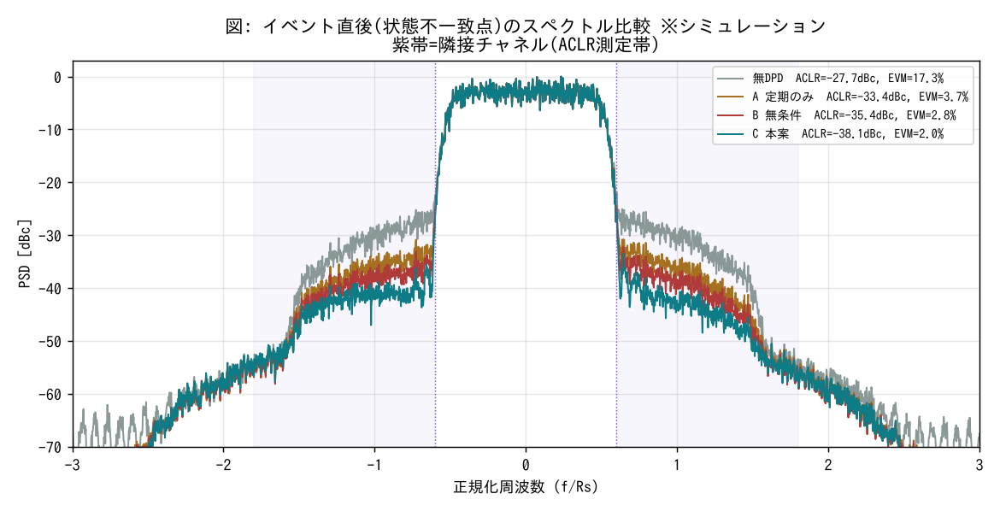

# A/B/C 係数更新方式の ACLR/EVM/NMSE 評価結果

> **重要：本書の数値はすべてシミュレーション値**（挙動モデル＋信号モデル）であり、**実測値ではない**。
> ACLR/EVM/NMSE の絶対値は実機測定で確定する。明細書原本・既存RTLは変更していない。
> 生成：`sim/dpd_abc_aclr_sim.py`（再現可）　記録日：2026-11-16

## 共通条件（3方式で同一）
- 信号：64QAM 単一キャリア、RRC α=0.2
- PA：Wiener型（線形メモリFIR → Saleh 静的非線形）。状態 g が動作条件（圧縮/温度）を表す
- メモリー効果：線形FIRタップで付与
- 状態変化：イベントで g が階段状に変化（イベント23回）。過渡 CAP=4 tick は観測無効
- 演算遅延：L=12 tick
- 方式：A＝定期更新のみ／B＝イベント無条件更新／C＝保留・再判定（本発明）

## 結果一覧（時間平均と最悪値, すべてシミュレーション）
| 方式 | ACLR平均[dBc] | ACLR最悪[dBc] | EVM平均[%] | EVM最悪[%] | NMSE[dB] | 誤適用[件] | 更新遅延[tick] | 再演算[回] |
|---|--:|--:|--:|--:|--:|--:|--:|--:|
| (参考) 無DPD | −26.0 | — | 18.3 | — | — | — | — | — |
| A 定期のみ | −33.9 | −26.6 | 3.51 | 7.90 | −27.3 | 8 | 18.0 | 24 |
| B イベント無条件 | −34.7 | −27.9 | 3.12 | 6.57 | −28.3 | **10** | **32.3** | 23 |
| **C 保留・再判定（本案）** | −34.4 | **−28.0** | 3.28 | 7.21 | −28.0 | **0** | **9.1** | **14** |

（ACLR/EVM/NMSE/誤適用/遅延は小さいほど良い。平均＝時間平均、最悪＝期間中の最大＝劣化のピーク。）

## スペクトル図（イベント直後＝状態不一致点）

同一スナップショット（状態 g=0.265）で各方式が持つ適用係数で現PAを駆動した時のPSD：
- 無DPD：ACLR −27.7 dBc / EVM 17.3%
- A 定期のみ（係数は旧状態 g=0.200＝stale）：−33.4 dBc / 3.7%
- B 無条件（過渡で fit, g=0.225＝誤）：−35.4 dBc / 2.8%
- **C 本案（整定後に正しく適用 g=0.250）：−38.1 dBc / 2.0%**
→ 誤適用が効くこの瞬間、**C が最も隣接チャネル再成長が小さい**（紫帯＝ACLR測定帯）。

## 読み取り（進歩性の観点）
- **平均の ACLR/EVM/NMSE は A/B/C で同等**（линеариз品質は3方式とも良好）。差は約1dB/0.5%以内で主眼ではない。
- **C の優位は動的指標**：**誤適用 0**（A=8, B=10）、**更新遅延 最小 9.1**（B=32.3）、**再演算 最小 14**（A=24, B=23）、**ACLR最悪も最良 −28.0**。
- すなわち C は、**A/B と同等の線形化品質を、無効観測・条件不一致での係数適用を起こさずに、少ない再演算と短い確定遅延で**達成する。
- B は毎イベント更新で品質平均は良いが、**過渡観測での fit による誤適用（10件）と大イベントでの遅延（32.3）**を伴う。A は応答が遅く不整合区間が長い。

## 実測との区別・今後
- 本評価は**シミュレーション**。ACLR/EVM/NMSE の**絶対値は実機（Cora Z7＋外付け変換器／実PA）で測定**して設定する（明細書の方針どおり）。
- 明細書への反映は「挙動モデル・未実測、ACLR/EVMは実機測定」と明記のうえ、効果の記載として用いる。

## 参照
- `sim/dpd_abc_aclr_sim.py`（本評価）／`sim/dpd_update_policy_sim.py`（制御レベルの比較）
- `docs/フェーズ1検証ログ.md`（T01〜T12＝14/14）／`docs/特許_実施形態と効果_反映メモ.docx`
